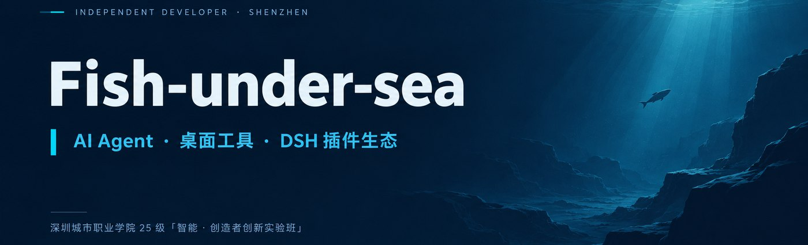

  <em>Turning "what could AI do for me" into "what I have already built."</em>

  
  
  

  <a href="README.md">简体中文</a> · <strong>English</strong>

---

## 🙋 About me

A student in the 2025 "Intelligent Founders Innovation Experimental Class" at Shenzhen City Polytechnic. I learn by building: start from a real need, then fill in the tech stack layer by layer.

Three things occupy most of my time:

- **AI agents** — wiring large models into real workflows instead of leaving them in a chat box (memory transcoding, conversational assistants, sentiment analysis — the kind of problem where "AI has to actually land").
- **Desktop tools** — for people who don't live in a terminal: fold a complicated process into one visual application.
- **The DSH plugin ecosystem** — writing plugins for the tools I use every day, until they add up to a reusable, distributable set.

## 🧰 Tech stack

<table>
<tr><td><b>Languages</b></td><td>

`Python` · `TypeScript` · `JavaScript` · `HTML` · `C++ (embedded)`

</td></tr>
<tr><td><b>Frontend / Desktop</b></td><td>

`React 18` · `Electron` · `Vite` · `Tailwind CSS` · `Flutter`

</td></tr>
<tr><td><b>Backend / AI</b></td><td>

`FastAPI` · `Flask` · `BERT fine-tuning` · `TensorFlow` · `OpenAI-compatible gateway` · `Ollama local inference`

</td></tr>
<tr><td><b>Hardware / Embedded</b></td><td>

`Raspberry Pi` · `ESP32-S3-EYE` · `PlatformIO` · `sensor acquisition and vision`

</td></tr>
<tr><td><b>Engineering</b></td><td>

`Git` · `pnpm workspace` · `Docker Compose` · `MinIO` · `PostgreSQL` · `Vitest`

</td></tr>
</table>

## ⭐ Featured projects

| Project | In one line | Language | Star |
|---------|-------------|----------|:----:|
| **[WinTunerPro](https://github.com/Fish-under-sea/WinTunerPro)** | A Windows desktop optimization tool for gaming companion providers and small studios, folding the whole "reinstall + optimize + beautify" workflow into one foolproof app | TypeScript · Electron | 3 |
| **[KouriChat](https://github.com/Fish-under-sea/KouriChat)** | A reworked build of KouriChat that adds the new `wxautox4` dependency, making the WeChat AI companion easier to get running | Python | 4 |
| **[MnemoTranscode](https://github.com/Fish-under-sea/MnemoTranscode)** | A "biological hard drive → digital hard drive" memory transcoder: extract chat history, structure it, feed it to a large model | Python · React · FastAPI | 2 |
| **[Cursor-IDE-zh-hans](https://github.com/Fish-under-sea/Cursor-IDE-zh-hans)** | A fully adapted Simplified Chinese language pack for Cursor, built on Microsoft's `vscode-loc` community project | Python | 3 |
| **[AgriSense](https://github.com/Fish-under-sea/AgriSense)** | A Raspberry Pi based AI smart greenhouse monitoring system: multi-sensor acquisition plus computer vision for full crop-cycle management | HTML · Python | 1 |
| **[dsh-fish](https://github.com/Fish-under-sea/dsh-fish)** | A self-built DSH (DeepSeek Harness) plugin bundle — one package installs every plugin I use | JavaScript | 0 |

## 📊 Project status overview

Status convention: as of 2026-09-30, **🟢 Active** means a commit within the last 2 months, **⏸️ Paused** means 2–6 months without a commit, and **🗄️ Completed** means more than 6 months without a commit (coursework kept for reference).

| Project | Status | Language | Last commit | Notes |
|---------|:------:|----------|-------------|-------|
| [dsh-fish](https://github.com/Fish-under-sea/dsh-fish) | 🟢 Active | JavaScript | 2026-09-29 | DSH plugin bundle; still adding plugins |
| [dsh-agent-teams-fish](https://github.com/Fish-under-sea/dsh-agent-teams-fish) | 🟢 Active | TypeScript | 2026-10-08 | DSH multi-agent team collaboration plugin (a supplement to upstream), shipping vendor avatars and badges in the package |
| [dsh-better-reasoning-effort-fish](https://github.com/Fish-under-sea/dsh-better-reasoning-effort-fish) | 🟢 Active | TypeScript | 2026-10-07 | DSH plugin: edit third-party models' reasoning effort and input modality right on the official Models page |
| [ego-link-ux-prototype](https://github.com/Fish-under-sea/ego-link-ux-prototype) | 🟢 Active | JavaScript | 2026-09-28 | AI interaction prototyping coursework, committed weekly |
| [WinTunerPro](https://github.com/Fish-under-sea/WinTunerPro) | ⏸️ Paused | TypeScript | 2026-06-24 | Feature-complete at v0.2.2; next round waits on real user feedback |
| [MnemoTranscode](https://github.com/Fish-under-sea/MnemoTranscode) | ⏸️ Paused | Python | 2026-05-21 | Skill-festival entry; iteration froze after the event |
| [skill-festival-submissions](https://github.com/Fish-under-sea/skill-festival-submissions) | ⏸️ Paused | TypeScript | 2026-05-14 | Fork of an upstream submission repository, kept for the record |
| [25IFIEC](https://github.com/Fish-under-sea/25IFIEC) | ⏸️ Paused | — | 2026-04-30 | Class information repository; updated only when the roster changes |
| [AgriSense](https://github.com/Fish-under-sea/AgriSense) | ⏸️ Paused | HTML | 2026-04-22 | Course project finished; resumes when hardware is available |
| [Cursor-IDE-zh-hans](https://github.com/Fish-under-sea/Cursor-IDE-zh-hans) | ⏸️ Paused | Python | 2026-04-14 | Waiting on upstream `vscode-loc` translation updates |
| [cursor-ai-monitor](https://github.com/Fish-under-sea/cursor-ai-monitor) | ⏸️ Paused | TypeScript | 2026-04-13 | VS Code extension prototype; the idea was validated and parked |
| [live2d-widget](https://github.com/Fish-under-sea/live2d-widget) | ⏸️ Paused | JavaScript | 2026-04-13 | A copy of upstream `stevenjoezhang/live2d-widget`, following upstream |
| [KouriChat](https://github.com/Fish-under-sea/KouriChat) | ⏸️ Paused | Python | 2026-03-25 | Stable since the rework; will follow a major `wxautox4` upstream release |
| [Campus-Text-Sentiment-Classification-System](https://github.com/Fish-under-sea/Campus-Text-Sentiment-Classification-System) | 🗄️ Completed | Python | 2025-12-24 | Course final project (autumn 2025), course finished |
| [Movie-Review-Sentiment-Analysis-System](https://github.com/Fish-under-sea/Movie-Review-Sentiment-Analysis-System) | 🗄️ Completed | Python | 2025-12-24 | Course final project (autumn 2025), course finished |

> Status changes with every commit; this table is maintained by hand and was last reviewed on 2026-09-30.

## 📮 Get in touch

- **Email**: 1661715118@qq.com
- **Issues**: Open an issue on any repository — I read them all (including paused projects, though I may not act on them).
- **Pull requests**: Welcome, especially patches for DSH plugins and desktop tools.

The banner on this page is a self-hosted image inside the repository (`assets/banner.jpg`) and depends on no external image host, so it stays readable in both light and dark themes. Badges use static shields.io images; if a badge fails to load, the page content and links are unaffected.
